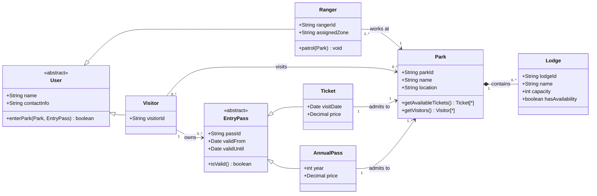

# National Parks UML

UML class diagram for a national park system.

## Design decisions

- `User` is the common base class for `Ranger` and `Visitor`.
- `Ranger` represents park staff; each ranger is assigned to a park.
- `Visitor` can enter a park with one of two entry-pass types:
  - `Ticket` grants entry to one park for a specific visit date.
  - `AnnualPass` grants entry to one or more parks during a year.
- `Park` contains lodges and keeps track of visitors and available tickets.

## Source

The diagram source is maintained in this README as Mermaid and can be edited in Mermaid-compatible UML tools or in GitHub.

Public project: https://github.com/Elvesenok/national-parks-uml
